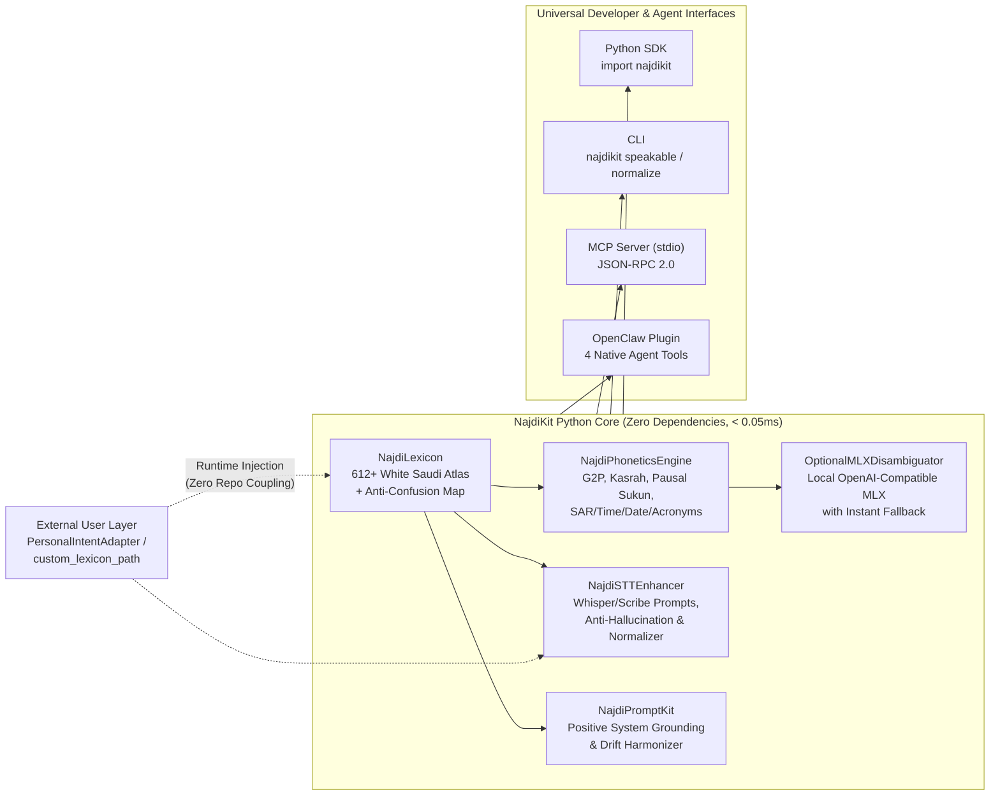

<div align="center">

# NajdiKit — نَجْدي كِت

**Sub-Millisecond Computational Linguistics, Phonetic TTS Engine, STT Post-Processor, and LLM Grounding Toolkit for Modern White Saudi & Urban Najdi Arabic**

**حزمة اللغويات الحاسوبية والصوتيات وتوجيه النماذج الذكية للّهجة السعودية البيضاء العصرية والنجدية الحضرية**

[](LICENSE)
[](pyproject.toml)
[-brightgreen.svg)](pyproject.toml)
[](benchmarks/run_benchmark.py)
[](ts-plugin/mcp-server.mjs)
[](openclaw.plugin.json)

[English Overview](#overview) • [Architecture](#architecture) • [Benchmarks](#benchmarks) • [Quick Start](#quick-start) • [MCP & OpenClaw](#mcp-server--openclaw-plugin) • [الدليل العربي الشامل](#الدليل-العربي-الشامل)

</div>

---

## Overview

Modern AI voice pipelines (`ElevenLabs`, `OmniVoice`, `OpenAI Audio`, `Whisper`, `Scribe`) and foundation LLMs (`Claude`, `GPT`, `Gemini`, `Qwen`, `Grok`) frequently struggle with **Modern White Saudi & Urban Najdi Arabic** (`اللهجة السعودية البيضاء العصرية والنجدية الحضرية`):

1. **TTS Morphological Stiffness:** Standard TTS models force formal MSA `fathah` on imperfective verb prefixes (`تَعْرِفُ`, `يَقُولُ`, `نَقْدِرُ`) and inject robotic case-ending tanween instead of authentic Saudi `kasrah` (`تِعْرِفْ`, `يِقُولْ`, `نِقْدَرْ`, `تِشُوفْ`) and natural conversational pausal `sukun` (`أَبْشِرْ`, `كِلْ شَيْ`, `الْحِينْ`, `تَمَامْ`).
2. **ASR / Whisper Hallucinations & Spelling Drift:** Silence segments trigger notorious subtitle hallucinations (`ترجمة نانسي`, `اشتركوا في القناة`), while colloquial words fragment into inconsistent spellings (`الحيين` / `ذلحين` / `انشاءالله`).
3. **LLM Dialect Confusion:** Prompting an LLM to "speak Saudi" without structured grounding often produces jarring mixes of Levantine (`بدي`, `هلق`, `شو`), Egyptian (`عايز`, `دلوقتي`), and stiff translated MSA (`سوف أقوم بالتحقق حالاً`).

**NajdiKit** solves all three problems deterministically in **~36 microseconds (`0.036 ms`)** using **100% Python `stdlib`** (zero mandatory third-party dependencies), with an optional local Apple Silicon `MLX` disambiguator and a ready-to-run **MCP Server** + **OpenClaw Plugin**.

---

## Comparison

| Capability | Generic Arabic NLP / Raw LLM | Heavy Neural Diacritizers | **NajdiKit** |
| :--- | :--- | :--- | :--- |
| **Target Register** | Formal MSA or mixed regional dialects | Classical / Newspaper MSA | **Modern White Saudi & Urban Najdi** |
| **Imperfective Verb Prefix (`تِـ/يِـ/نِـ`)** | Defaults to MSA `fathah` (`تَعْرِفُ`) | Forces MSA `fathah` + `dammah` | **Authentic Saudi `kasrah` + pausal `sukun` (`تِعْرِفْ`)** |
| **Saudi Currency, Time & Numbers** | Inconsistent (`مائة وخمسون ريالاً`) | Unhandled | **Spoken White Saudi (`مِيَّة وَخَمْسِينْ رِيَالْ`, `خَمْسْ إِلَّا رُبْعْ`)** |
| **Whisper / Scribe Anti-Hallucination** | None | None | **Built-in conditioning prompts + silence filter** |
| **Runtime Dependencies** | Cloud APIs or large packages | PyTorch / Transformers (`>1 GB`) | **Zero (`stdlib` only; optional local `MLX`)** |
| **Typical Latency** | `250 ms – 1,500 ms` | `15 ms – 120 ms` | **`0.023 ms – 0.037 ms` (`23–37 µs`)** |
| **Privacy & Data Isolation** | External network calls | Local heavy weights | **100% Offline + Clean `PersonalIntentAdapter` Hook** |

---

## Architecture



---

## Benchmarks

Measured via `python3 benchmarks/run_benchmark.py --rounds 3000` across multi-sentence Arabic/mixed corpora (`612` indexed lexicon entries, cold initialization `~6.1 ms`):

| Engine Operation | Mean (µs) | Mean (ms) | P50 (µs) | P95 (µs) | Throughput (ops/sec) |
| :--- | ---: | ---: | ---: | ---: | ---: |
| `lexicon.lookup` | `0.09 µs` | `0.0001 ms` | `0.08 µs` | `0.12 µs` | `10,632,000 / sec` |
| `phonetics.prepare_tts` | `36.46 µs` | `0.0365 ms` | `35.17 µs` | `46.12 µs` | `27,400 / sec` |
| `stt.postprocess_transcript` | `22.63 µs` | `0.0226 ms` | `24.96 µs` | `32.79 µs` | `44,100 / sec` |
| `stt.build_stt_prompt` | `0.49 µs` | `0.0005 ms` | `0.50 µs` | `0.54 µs` | `2,024,000 / sec` |
| `prompt_kit.build_grounding` | `0.90 µs` | `0.0009 ms` | `0.88 µs` | `0.92 µs` | `1,112,000 / sec` |

---

## Quick Start

### Installation

```bash
# Editable or standard install (zero external dependencies)
pip install -e .

# Optional Apple Silicon MLX extras
pip install -e ".[mlx]"
```

### 1. Python SDK

```python
from najdikit import (
    to_speakable,
    postprocess_transcript,
    build_stt_prompt,
    build_system_grounding,
    get_default_lexicon,
)

# 1) Prepare natural White Saudi / Urban Najdi TTS input
tts_text = to_speakable(
    "أبشر، شيكت على الفاتورة الحين بمبلغ 150.50 ريال قبل الساعة 4:45 العصر عبر API "
    "لطلب 550e8400-e29b-41d4-a716-446655440000"
)
print(tts_text)
# -> أَبْشِرْ، شَيَّكْتْ على الْفَاتُورَة الْحِينْ بمبلغ مِيَّة وَخَمْسِينْ رِيَالْ وَخَمْسِينْ هَلَلَة قبل السَّاعَة خَمْسْ إِلَّا رُبْعْ الْعَصْرْ عبر إِي بِي آيْ لطلب

# 2) Clean Whisper / Scribe transcripts & strip silence hallucinations
cleaned = postprocess_transcript(
    "ان شاء الله بشيك ع الموضوع الحيين وكل شيء تمام لا هنت. اشتركوا في القناة"
)
print(cleaned.text)
# -> إن شاء الله بشيك ع الموضوع الحين وكل شي تمام لاهنت.

# 3) Generate Whisper / Scribe contextual conditioning prompts
stt_cfg = build_stt_prompt(domain="tech", extra_terms=["داشبورد", "سيرفر"])
print(stt_cfg["initial_prompt"])

# 4) Positive System Grounding for Claude / GPT / Gemini / Qwen / Grok
grounding = build_system_grounding(profile="modern_white")
print(grounding.system_prompt)

# 5) O(1) Lexicon lookup
entry = get_default_lexicon().lookup("يمديك")
print(entry.vocalized, "—", entry.meaning_en)
# -> يِمْدِيكْ — Can you / Do you have time to?
```

### 2. Privacy-Safe Personal Adapter Hook (`Zero Personal Data in Repo`)

Any organization or individual user can inject private domain names, shortcuts, or custom pronunciations **at runtime** without modifying `NajdiKit`:

```python
import os
from najdikit import NajdiLexicon, DictionaryPersonalAdapter, postprocess_transcript

# Option A: Runtime Python Protocol / Adapter
adapter = DictionaryPersonalAdapter(
    replacements={"بوابة الدفع الداخلية": "PayCore-Gateway"},
    intent_aliases={"PayCore-Gateway": "inspect_gateway"},
)
result = postprocess_transcript("شيكت على بوابة الدفع الداخلية ذلحين", personal_adapter_hook=adapter)
print(result.text, "| intent:", result.matched_intent)
# -> شيكت على PayCore-Gateway الحين | intent: inspect_gateway

# Option B: External private JSON overlay outside the repository
custom_path = os.path.expanduser("~/.config/najdikit/custom_lexicon.local.json")
# NajdiLexicon(custom_lexicon_path=custom_path)
```

### 3. Command-Line Interface (`CLI`)

```bash
# Vocalize text for TTS
python3 -m najdikit speakable "تعرف وشلون نقدر نرفع التحديث الحين؟"

# Clean & normalize STT output
python3 -m najdikit normalize "انشاءالله كل شيء يضبط الحيين لا هنت"

# Generate Whisper / Scribe prompt
python3 -m najdikit stt-prompt --domain finance --terms "تسوية,مطابقة"

# Emit LLM system grounding prompt
python3 -m najdikit grounding --profile executive

# Search the 612-entry lexicon
python3 -m najdikit lookup "ما قصر"
python3 -m najdikit lookup --stats

# Run microsecond benchmark suite
python3 -m najdikit bench
```

---

## MCP Server & OpenClaw Plugin

`NajdiKit` ships with a dependency-free **JSON-RPC 2.0 `stdio` MCP Server** ([`ts-plugin/mcp-server.mjs`](ts-plugin/mcp-server.mjs)) and an **OpenClaw Plugin** ([`openclaw.plugin.json`](openclaw.plugin.json) + [`ts-plugin/index.mjs`](ts-plugin/index.mjs)) exposing four tools:

- `najdi_tts_prepare` — Phonetic G2P, Najdi `kasrah`, pausal `sukun`, currency/time/acronym expansion.
- `najdi_stt_clean` — Whisper/Scribe hallucination stripping, orthographic normalization, and carry prompts.
- `najdi_style_grounding` — Positive system prompt builder & dialect-drift harmonizer.
- `najdi_lexicon_lookup` — Instant search across `612+` Modern White Saudi & Urban Najdi entries.

### MCP Configuration (`Claude Desktop` / `Cursor` / `Antigravity` / `Codex`)

```json
{
  "mcpServers": {
    "najdikit": {
      "command": "node",
      "args": ["./ts-plugin/mcp-server.mjs"],
      "env": {
        "NAJDIKIT_LOCAL_LLM_URL": ""
      }
    }
  }
}
```

---

<div dir="rtl" align="right">

## الدليل العربي الشامل

صُممت حزمة **`NajdiKit`** لتكون المرجع الهندسي المفتوح المصدر لمعالجة **اللهجة السعودية البيضاء العصرية والنجدية الحضرية** بأعلى معايير السرعة والدقة والخصوصية:

1. **أطلس معجمي غني (`612` مفردة وعبارة مصنفة):** يغطي التحيات واللباقة اليومية (`أبشر`، `سم`، `لاهنت`، `بيض الله وجهك`، `ما قصر`)، أفعال الرغبة والإدراك والحركة (`أبي`، `ودّي`، `يمديك`، `توّي`، `شيكت`)، الروابط الحوارية (`اللي`، `هذي`، `الحين`، `عشان`، `ترا`، `عساه`)، ومصطلحات التقنية والمال والأعمال العصرية، بالإضافة إلى جدول تصحيح خلط اللهجات الشائعة في نماذج الذكاء الاصطناعي.
2. **محرك الصوتيات والتشكيل النجدي (`phonetics.py`):** يضبط كسرة حرف المضارعة (`تِعْرِفْ`، `يِقُولْ`، `نِقْدَرْ`، `تِشُوفْ`)، والتسكين الوقفي الطبيعي بدل التنوين المتكلف، والشدّات الدقيقة، مع تحويل الريال والهللة والدولار والنسب المئوية والأوقات (`ونص`، `وربع`، `إلا ربع`) والتواريخ والاختصارات التقنية إلى نطق عربي سعودي سلس.
3. **تنقيح التفريغ الصوتي ومنع الهلوسة (`stt_enhancer.py`):** يولّد محفزات سياقية متوازنة لمحركات `Whisper` و`Scribe`، ويحذف هلوسات الصمت والترجمات الوهمية، ويوحّد الإملاء السعودي الأبيض، مع دعم خطاف توسعة نظيف (`PersonalIntentAdapter`) يتيح ربط أي قاموس خاص وقت التشغيل دون تضمين أي بيانات شخصية في المستودع العام.
4. **توجيه النماذج اللغوية الإيجابي (`prompt_kit.py`):** يبني توجيهات نظام رشيقة (`modern_white`, `executive`, `voice_assistant`, `technical`) تجعل أي نموذج لغوي يتحدث بلهجة سعودية بيضاء طبيعية وموزونة دون حشو أو تصنع.

</div>

---

## Testing & Verification

```bash
# Run all 46 unit, CLI, MCP protocol, OpenClaw plugin, and hygiene tests
python3 -m unittest discover -s tests -v

# Run full benchmark suite (< 0.3ms gate)
python3 benchmarks/run_benchmark.py
```

## License

Released under the [MIT License](LICENSE).
