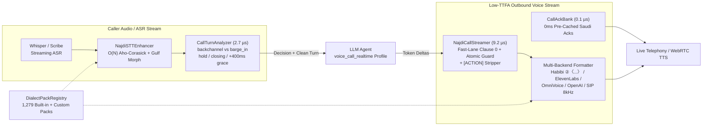

<div align="center">

# NajdiKit v2.0 — نَجْدي كِت

**Microsecond Real-Time Voice Call Engine, Gulf/Najdi Clitic Morphology, Multi-Backend TTS G2P/Tashkeel, STT Post-Processor, Modular Dialect Packs & Alignment Scorer for Modern White Saudi Arabic**

**المحرك الصوتي الفوري للمكالمات الحية، والتحليل الصرفي الخليجي/النجدي، والتشكيل الصوتي متعدد المحركات، وتنقيح التفريغ الصوتي، وتقييم نقاء اللهجة السعودية البيضاء العصرية**

[](pyproject.toml)
[](LICENSE)
[](pyproject.toml)
[-brightgreen.svg)](pyproject.toml)
[-orange.svg)](benchmarks/run_benchmark.py)
[](ts-plugin/mcp-server.mjs)

[What's New in v2.0](#whats-new-in-v20) • [Real-Time Voice Calls](#real-time-voice-call--telephony-pipeline) • [Benchmarks](#benchmarks-v20) • [Quick Start](#quick-start) • [MCP & OpenClaw](#mcp-server--openclaw-plugin-7-tools) • [الدليل العربي الشامل](#الدليل-العربي-الشامل)

</div>

---

## What's New in v2.0

**NajdiKit v2.0** transforms Saudi Arabic voice AI from offline text preprocessing into a **full-duplex, microsecond-grade real-time telephony & linguistic engine** — still with **zero mandatory dependencies (`100% Python stdlib`)**:

1. **Real-Time Voice Call & Telephony Engine (`voice_call.py`):**
   - **`NajdiCallStreamer` (`~9 µs`):** Stateful token-by-token LLM stream chunker engineered for minimum Time-To-First-Audio (`TTFA`). Features **First-Clause Fast Lane** on Saudi openers (`أبشر،` / `سم،` / `هلا والله،`), **Atomic Guard** (never splits inside `1,250.50 ريال`, `3.85`, `4:30`, `إن شاء الله`, `في أمان الله`, or standalone prepositions), **Breath-Group Overflow Splitter** (`12` words default / `8` words for `sip_8khz` before `وعشان`/`وبعدين`/`بس`), and split-token safe **`[ACTION: ...]`** extraction.
   - **`CallTurnAnalyzer` (`~2.7 µs`):** Full-duplex turn-taking classifier distinguishing `"backchannel"` (`طيب`, `إيه`, `كمّل` → `should_abort_tts=False` even while AI is speaking!) from `"barge_in"` (`لحظة`, `وقف`, `لا لا` → `should_abort_tts=True`), `"hold_request"` (`ثواني`, `خلك معي` → `20s` wait + vocalized ack), `"closing"` (`في أمان الله`, `توصي شي`), and `"incomplete_thought"` (`يعني`, `عشان`, `اللي` → `+400ms` VAD grace).
   - **`CallAckBank` (`0.12 µs`):** Pre-vocalized White Saudi call acknowledgments ready for `0ms` pre-cached audio buffers (`lookup`, `action`, `confirm`, `hold`, `unclear`).
   - **Multi-Backend TTS Formatter:** Native output profiles for **`SWivid/Habibi-TTS`** (`②〈...〉` Saudi dialect token), **`ElevenLabs Flash v2.5/v3`**, **`OmniVoice`** (explicit gemination respelling `شَيْيَكْتْ`), **`OpenAI Audio`**, and **`SIP 8kHz`**.
2. **Zero-Dependency Gulf & Najdi Clitic Morphology (`morphology.py`, `~2.2 µs`):**
   - Decomposes proclitics (`و`, `ف`, `ب`, `ل`, `ك`, `ال`, future `بـ`, demonstrative `هالـ` with sun/moon assimilation: `هالموضوع` → `هَاالْمَوْضُوعْ`, `هالشغلة` → `هَاالشَّغْلَةْ`) and compound enclitics (`وبنشيكها` → `وَبِنْشَيِّكْهَا`, `بيعتمدونها` → `بِيِعْتَمِدُونْهَا`, `خلصتوها` → `خَلَّصْتُوهَا`, `بمكالماتهم` → `بِمُكَالَمَاتْهُمْ`).
3. **Compiled `O(N)` Aho-Corasick & Modular `DialectPackRegistry` (`packs.py`, `1,279` Entries):**
   - Compiled `TokenAhoCorasick` scans **`10,500+` patterns in `~9.0 µs`** (`>110,000 ops/sec`), paired with `PhraseRadixTrie` (`O(L)` greedy multi-word vocalization).
   - Ships with **core + 4 built-in domain packs** (`telephony_calls`, `sada_conversational`, `commerce_fintech`, `service_appointments`) totaling **`1,279` unique vocalized entries**, extensible at runtime via `NAJDIKIT_PACKS_DIR` with lock-free immutable snapshots.
4. **Saudi Dialect Purity & Call-Suitability Scorer (`scoring.py`, `~10.4 µs`):**
   - Inspired by `Saudi-Dialect-ALLaM` alignment evaluation — returns `saudi_alignment_score`, `msa_leakage_score`, `foreign_dialect_score`, `call_suitability_score`, exact `flagged_spans`, and White Saudi replacement suggestions.

---

## Real-Time Voice Call & Telephony Pipeline



---

## Benchmarks (v2.0)

Measured via `python3 benchmarks/run_benchmark.py --rounds 2000` across multi-sentence Saudi telephony, fintech, and tech corpora (`1,279` unique lexicon entries across `5` packs, plus a `10,500`-pattern scale automaton; cold initialization `~12.8 ms`):

| Engine Operation | Mean (µs) | Mean (ms) | P50 (µs) | P95 (µs) | Throughput (ops/sec) |
| :--- | ---: | ---: | ---: | ---: | ---: |
| `lexicon_lookup` | `0.09 µs` | `0.0001 ms` | `0.08 µs` | `0.12 µs` | `10,569,000 / sec` |
| `call_ack_bank_0ms` | `0.12 µs` | `0.0001 ms` | `0.12 µs` | `0.17 µs` | `8,087,000 / sec` |
| `stt_prompt_build` | `0.75 µs` | `0.0008 ms` | `0.50 µs` | `0.54 µs` | `1,324,000 / sec` |
| `prompt_grounding_build` | `0.93 µs` | `0.0009 ms` | `0.88 µs` | `1.00 µs` | `1,078,000 / sec` |
| `morphology_analyze` *(uncached)* | `2.24 µs` | `0.0022 ms` | `1.62 µs` | `4.58 µs` | `446,000 / sec` |
| `call_turn_analyze` | `2.66 µs` | `0.0027 ms` | `2.46 µs` | `3.46 µs` | `376,000 / sec` |
| `aho_corasick_10k_scan` *(10.5K patterns)* | `9.02 µs` | `0.0090 ms` | `9.04 µs` | `10.50 µs` | `110,800 / sec` |
| `call_stream_chunk` | `9.19 µs` | `0.0092 ms` | `9.46 µs` | `10.75 µs` | `108,800 / sec` |
| `dialect_score` | `10.42 µs` | `0.0104 ms` | `10.17 µs` | `11.25 µs` | `95,900 / sec` |
| `stt_postprocess` | `23.03 µs` | `0.0230 ms` | `25.67 µs` | `33.62 µs` | `43,400 / sec` |
| `call_stream_vocalized` *(chunk + full G2P)* | `38.57 µs` | `0.0386 ms` | `28.25 µs` | `62.46 µs` | `25,900 / sec` |
| `phonetics_prepare_tts` | `39.88 µs` | `0.0399 ms` | `39.38 µs` | `52.04 µs` | `25,000 / sec` |
| `tts_multi_backend` | `42.12 µs` | `0.0421 ms` | `41.58 µs` | `56.00 µs` | `23,700 / sec` |

---

## Quick Start

### Installation

```bash
# Standard install (100% Python stdlib — zero external dependencies)
pip install -e .

# Optional Apple Silicon MLX extras
pip install -e ".[mlx]"
```

### 1. Real-Time Voice Call Streaming & Full-Duplex Turn Management

```python
from najdikit import (
    NajdiCallStreamer,
    analyze_turn,
    format_for_tts_backend,
    get_call_ack,
)

# 1) 0ms pre-cached White Saudi call acknowledgment while tool/DB runs
print(get_call_ack("lookup"))
# -> ثَوَانِي أَشَيِّكْ لِكْ.

# 2) Token-by-token LLM stream chunking with First-Clause Fast Lane & Atomic Guard
streamer = NajdiCallStreamer(backend="elevenlabs")
for token in ["أبشر، ", "المبلغ ", "1,250", ".", "50 ريال ", "[ACT", "ION: send_sms] ", "الساعة 4:30 العصر."]:
    for clause in streamer.push(token):
        print(f"[Clause {clause.index} | fast={clause.is_fast_lane}] {clause.speakable}")
for clause in streamer.flush():
    print(f"[Clause {clause.index} | final={clause.is_final}] {clause.speakable}")
print("Actions:", streamer.extracted_actions)
# [Clause 0 | fast=True] أَبْشِرْ،
# [Clause 1 | final=True] المبلغ أَلْفْ وَمِيتَيْنْ وَخَمْسِينْ رِيَالْ وَخَمْسِينْ هَلَلَة السَّاعَة أَرْبَعْ وَنُصّ الْعَصْرْ.
# Actions: ['send_sms']

# 3) Full-duplex caller turn analysis (< 3 µs)
print(analyze_turn("طيب كمّل", is_ai_speaking=True))
# -> TurnDecision(kind='backchannel', should_abort_tts=False, endpoint_grace_ms=0, ...)

print(analyze_turn("لحظة بس سؤال", is_ai_speaking=True))
# -> TurnDecision(kind='barge_in', should_abort_tts=True, endpoint_grace_ms=0, ...)

print(analyze_turn("أبي أستفسر عن الفاتورة اللي", is_ai_speaking=False))
# -> TurnDecision(kind='incomplete_thought', should_abort_tts=False, endpoint_grace_ms=400, ...)

# 4) Multi-backend TTS formatting (Habibi-TTS, OmniVoice, ElevenLabs, OpenAI, SIP 8kHz)
print(format_for_tts_backend("أبشر شيكت على هالفاتورة", backend="habibi"))
# -> ②〈أَبْشِرْ شَيَّكْتْ عَلَى هَاالْفَاتُورَةْ〉

print(format_for_tts_backend("شيكت الحين", backend="omnivoice"))
# -> شَيْيَكْتْ الْحِينْ
```

### 2. Gulf/Najdi Clitic Morphology, Dialect Scoring & Modular Packs

```python
from najdikit import (
    NajdiMorphAnalyzer,
    DialectPack,
    get_default_pack_registry,
    score_dialect,
)

# 1) Gulf & Najdi clitic decomposition (< 3 µs)
morph = NajdiMorphAnalyzer()
for word in ("وبنشيكها", "بيعتمدونها", "خلصتوها", "هالموضوع", "هالشغلة", "بمكالماتهم"):
    res = morph.analyze(word)
    print(f"{word} -> {res.vocalized} (proc={res.proclitics}, stem={res.stem}, enc={res.enclitics})")
# وبنشيكها -> وَبِنْشَيِّكْهَا (proc=('و', 'ب'), stem=نشيك, enc=('ها',))
# بيعتمدونها -> بِيِعْتَمِدُونْهَا (proc=('ب',), stem=يعتمد, enc=('ونها',))
# خلصتوها -> خَلَّصْتُوهَا (proc=(), stem=خلص, enc=('توها',))
# هالموضوع -> هَاالْمَوْضُوعْ (proc=('هال',), stem=موضوع, enc=())
# هالشغلة -> هَاالشَّغْلَةْ (proc=('هال',), stem=شغلة, enc=())
# بمكالماتهم -> بِمُكَالَمَاتْهُمْ (proc=('ب',), stem=مكالمة, enc=('ات', 'هم'))

# 2) Saudi Dialect Alignment & Call-Suitability Scorer (< 11 µs)
evaluation = score_dialect("سوف أقوم بالتحقق من الأمر الذي ذكرته حسناً")
print(evaluation.saudi_alignment_score, evaluation.msa_leakage_score, evaluation.suggestions)

# 3) Plug-and-play modular DialectPacks (or set NAJDIKIT_PACKS_DIR=/path/to/packs)
registry = get_default_pack_registry()
print([p["id"] for p in registry.list_packs()])
# -> ['telephony_calls', 'sada_conversational', 'commerce_fintech', 'service_appointments']
```

### 3. Privacy-Isolated Runtime Hooks (`Zero Personal Data in Repo`)

External applications can inject private vocabularies, user shortcuts, or enterprise packs **at runtime** without touching repository files:
- `NajdiLexicon(custom_lexicon_path="~/.config/najdikit/custom.json")` or `NAJDIKIT_CUSTOM_LEXICON`
- `NAJDIKIT_PACKS_DIR="~/.config/najdikit/packs"` for modular industry/enterprise JSON packs
- `PersonalIntentAdapter` protocol / `DictionaryPersonalAdapter` or `NAJDIKIT_PERSONAL_ADAPTER_JSON` for STT post-processing

### 4. Command-Line Interface (`11 Subcommands`)

```bash
python3 -m najdikit speakable --backend habibi "أبشر، شيكت على هالفاتورة بمبلغ 150 ريال"
python3 -m najdikit call-chunks "أبشر، المبلغ 1,250.50 ريال [ACTION: send_receipt]."
python3 -m najdikit turn-check --ai-speaking "طيب كمّل"
python3 -m najdikit normalize "انشاءالله نخلص هالفاتوره وذلحين نرسلها لا هنت"
python3 -m najdikit stt-prompt --domain telephony --terms "تحويل,تأكيد"
python3 -m najdikit score "أنا بدي أشوف الموضوع هلق"
python3 -m najdikit morph "وبنشيكها"
python3 -m najdikit packs
python3 -m najdikit grounding --profile voice_call_realtime
python3 -m najdikit lookup "ثواني أشيك لك" --pack-id telephony_calls
python3 -m najdikit bench
```

---

## MCP Server & OpenClaw Plugin (`7 Tools`)

`NajdiKit v2.0` ships with a zero-dependency **JSON-RPC 2.0 `stdio` MCP Server** ([`ts-plugin/mcp-server.mjs`](ts-plugin/mcp-server.mjs)) and an **OpenClaw Plugin** ([`openclaw.plugin.json`](openclaw.plugin.json) + [`ts-plugin/index.mjs`](ts-plugin/index.mjs)) exposing **7 native agent tools**:

| Tool Name | Purpose |
| :--- | :--- |
| `najdi_tts_prepare` | Multi-backend Saudi G2P & tashkeel (`default`, `elevenlabs`, `habibi`, `omnivoice`, `openai`, `sip_8khz`). |
| `najdi_call_stream_chunk` | Low-TTFA real-time call breath-group chunker + `[ACTION: ...]` extractor + `0ms` acks. |
| `najdi_call_turn_analyze` | Full-duplex caller turn classifier (`backchannel`, `barge_in`, `hold_request`, `closing`, `incomplete_thought`, `complete_turn`). |
| `najdi_stt_clean` | Whisper/Scribe hallucination stripping, `O(N)` orthographic normalization, and `telephony` carry prompts. |
| `najdi_dialect_score` | `0–100` Saudi alignment, MSA leakage, foreign dialect drift & call-suitability scorer. |
| `najdi_style_grounding` | Positive system prompt builder (`modern_white`, `executive`, `voice_assistant`, `voice_call_realtime`, `technical`). |
| `najdi_lexicon_lookup` | Search across `1,279+` vocalized entries & modular domain packs. |

```json
{
  "mcpServers": {
    "najdikit": {
      "command": "node",
      "args": ["./ts-plugin/mcp-server.mjs"],
      "env": {
        "NAJDIKIT_PACKS_DIR": "",
        "NAJDIKIT_LOCAL_LLM_URL": ""
      }
    }
  }
}
```

---

<div dir="rtl" align="right">

## الدليل العربي الشامل

صُمم الإصدار الثاني **`NajdiKit v2.0`** ليكون المحرك الهندسي المرجعي المفتوح المصدر لمعالجة **اللهجة السعودية البيضاء العصرية والنجدية الحضرية** في **المكالمات الصوتية الفورية (`Real-Time Telephony`)** والوكلاء الأذكياء بسرعة تقاس بالميكروثانية (`2–40 µs`) وبدون أي اعتماديات خارجية:

1. **محرك المكالمات الصوتية الفورية (`voice_call.py`):**
   - **`NajdiCallStreamer`:** يقطّع تدفق كلمات النموذج اللغوي لحظياً لتقليل زمن أول نطق (`TTFA`) عبر المسار السريع للافتتاحيات السعودية (`أبشر،` / `سم،` / `هلا والله،`)، مع حارس ذري يمنع الكسر داخل الأرقام والعملات والأوقات (`1,250.50 ريال`، `4:30`) والعبارات المتلازمة (`إن شاء الله`، `في أمان الله`، `طال عمرك`)، ومقسّم ذكي للجمل الطويلة قبل الروابط السعودية (`وعشان`، `وبعدين`، `بس`)، وعزل آمن لوسوم `[ACTION: ...]` دون تسريبها للنطق.
   - **`CallTurnAnalyzer`:** يحلل كلام المتصل في أقل من `3 µs` للتمييز بين المتابعة السماعية (`طيب`، `إيه`، `كمّل` ← لا يقطع صوت المساعد) والمقاطعة الفعلية (`لحظة`، `وقف`، `بس سؤال` ← يوقف النطق فوراً)، وطلب الانتظار (`ثواني`، `خلك معي`)، وإنهاء المكالمة (`في أمان الله`، `توصي شي`)، والجمل غير المكتملة (`يعني`، `عشان`، `اللي` ← مهلة `400ms` إضافية).
   - **توافق متعدد المحركات الصوتية:** يدعم `SWivid/Habibi-TTS` بالرمز السعودي `②〈...〉`، و`ElevenLabs Flash v2.5/v3`، و`OmniVoice` (فك التضعيف الصوتي `شَيْيَكْتْ`)، و`OpenAI Audio`، وهواتف `SIP 8kHz`.
2. **المحلل الصرفي للواصق الخليجية والنجدية (`morphology.py`):** يفكك السوابق (`و`، `ف`، `ب`، `ل`، `ال`، `بـ` الاستقبالية، و`هالـ` الإشارية مع الإدغام الشمسي والقمري مثل `هالموضوع` ← `هَاالْمَوْضُوعْ` و`هالشغلة` ← `هَاالشَّغْلَةْ`) واللواحق المركبة (`وبنشيكها`، `بيعتمدونها`، `خلصتوها`، `بمكالماتهم`) بسرعة `~2.2 µs`.
3. **التوسع المعياري ومحرك `Aho-Corasick` المترجم (`packs.py`):** يضم **`1,279` مفردة وعبارة فريدة مشكّلة بالكامل** موزعة بين المعجم الأساسي و٤ حزم مجالية مدمجة (`telephony_calls`, `sada_conversational`, `commerce_fintech`, `service_appointments`) مع قابلية تحميل آلاف المصطلحات الإضافية عبر `NAJDIKIT_PACKS_DIR` بزمن مسح خطي `O(N)` لا يتجاوز `~9 µs` حتى عند `10,500+` نمط.
4. **مقياس نقاء اللهجة وملاءمة المكالمات (`scoring.py`):** يقيّم مدى اتساق النص مع البيضاء السعودية (`0–100`) ويكشف تسرب الفصحى المترجمة أو اللهجات الأخرى مع اقتراحات بديلة فورية.

</div>

---

## Testing & Verification

```bash
# Run all 80 unit, morphology, voice-call, scale, CLI, MCP, OpenClaw & hygiene tests
python3 -m unittest discover -s tests -v

# Run full microsecond benchmark suite (< 0.1ms gate + sub-gates)
python3 benchmarks/run_benchmark.py
```

## License

Released under the [MIT License](LICENSE).
